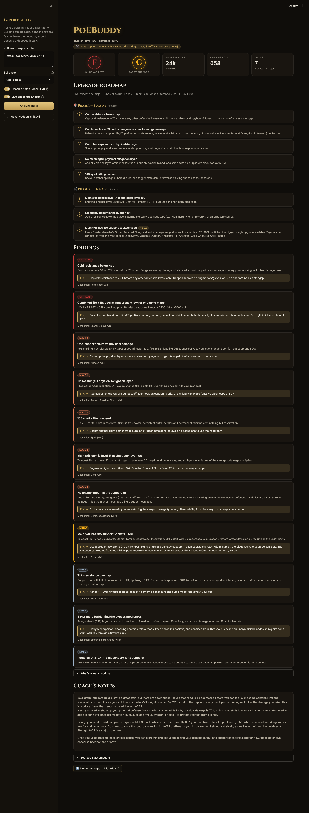

# PoEBuddy

Paste your **Path of Building** export, get a **build improvement report** for
Path of Exile 2.

PoEBuddy grades your build's survivability and damage, then lays out a staged
**upgrade roadmap**:

1. **🛡️ Survive** — resistance caps and overcap, chaos res, life/ES pool,
   largest survivable hit per damage type, mitigation layers, recovery,
   unused spirit
2. **⚔️ Damage** — DPS benchmarks matched to what your build actually scales
   (hits, damage-over-time, or minions), empty support sockets with
   tag-matched gem candidates, gem level/quality lag, accuracy
3. **💰 Divines per hour** — movement speed and the cheapest remaining wins,
   priced in current-league currency via poe.ninja

Group-play support builds (aura/curse bots) are auto-detected — or set the
role manually — and graded on **party contribution** instead of personal DPS:
buff coverage, enemy debuffs, curse limits.

Every number is deterministic: computed from PoB's own stat sheet and checked
against a local snapshot of the PoE2 wiki, with citations. The only LLM output
is an optional "coach's notes" narrative that rephrases the findings — it
cannot introduce numbers or mechanics. No chatbot.

Everything runs locally, with two opt-in network exceptions: fetching a pasted
pobb.in link, and cached poe.ninja price data (the report works fully without
both).

## Example report

A level 100 Invoker build (Runes of Aldur league) run through PoEBuddy:



## How it works

```
PoE2 wiki (MediaWiki API)
      |  ingestion/fetch_wiki.py   (polite, cached, incremental)
      v
  normalize -> chunk -> index      ingestion/
      v
  ┌───────────────┬─────────────────┬────────────────────┐
  │ Qdrant        │ BM25 keyword    │ DuckDB structured  │
  │ (embedded)    │ index           │ facts              │
  └───────────────┴─────────────────┴────────────────────┘
      |  app/retrieval.py  dense + BM25 -> RRF -> rerank
      v
  PoB import (app/pob_import.py)   pobb.in link / export code -> Build
      v
  app/archetype.py   what does this build scale? DPS or support role?
  app/analysis.py    deterministic checks vs PoE2 benchmarks
      v
  app/report.py      staged roadmap + costs (app/ninja.py) + coach notes
      v
  Streamlit report UI (app/report_ui.py)
```

## Project layout

```
poebuddy/
├── app/
│   ├── settings.py      config loader (config/settings.yaml + .env)
│   ├── llm.py           Ollama chat + embeddings wrapper
│   ├── retrieval.py     hybrid dense+BM25+RRF+rerank wiki search
│   ├── db.py            DuckDB access (read-only)
│   ├── build_parser.py  canonical build schema (Pydantic)
│   ├── pob_import.py    Path of Building link/code importer
│   ├── archetype.py     build-context detection + support suggestions
│   ├── analysis.py      deterministic checks vs benchmarks
│   ├── ninja.py         poe.ninja price data (cached)
│   ├── report.py        roadmap assembly + coach notes
│   ├── ui_theme.py      visual theme + HTML components
│   └── report_ui.py     Streamlit entry point
├── ingestion/           wiki fetch -> normalize -> chunk -> index
├── config/settings.yaml all tunables (benchmarks included)
├── build_index.py       one-shot ingestion pipeline
└── setup.sh             venv + dependencies bootstrap
```

## Setup

Built for Apple Silicon Mac + embedded Qdrant (no Docker). Linux should work
with minor path changes.

### 1. Install runtimes

```bash
brew install python@3.11
brew install --cask ollama          # or https://ollama.com
```

Open the Ollama app once so its server starts (`http://localhost:11434`).

### 2. Environment

```bash
./setup.sh                          # creates .venv, installs deps, seeds .env
```

Edit `.env`: set a **real contact address** in `WIKI_USER_AGENT` (required
for responsible wiki scraping), and confirm model names match `ollama list`:

```bash
ollama pull llama3.1:8b-instruct-q4_K_M
ollama pull nomic-embed-text
```

### 3. Build the wiki index

Smoke test first, then the full build (fetches ~8k pages politely at ~1 req/s
and embeds every chunk locally — takes a while):

```bash
python build_index.py --limit 40    # smoke test
python build_index.py               # full build
```

Re-runs are incremental (content-hash cached). After a game patch, bump
`game.current_version` in `config/settings.yaml` and re-run.

### 4. Run

```bash
streamlit run app/report_ui.py
```

Paste a pobb.in link or a raw PoB export code, pick a role (or auto-detect),
and hit **Analyze build**.

## Tuning

Benchmark thresholds live in `config/settings.yaml` under `analysis:` —
pool/max-hit/DPS tier bands are community heuristics, deliberately
config-editable. Game-rule values (res caps, penalties) come from the wiki
and only change on patch.

## Responsible data use

The wiki fetcher identifies itself, rate-limits, caches by content hash, and
retains title/revision/source attribution. poe.ninja calls use only their
[documented public economy endpoints](https://poe.ninja/docs/api), cached for
hours. Do not redistribute fetched wiki data without checking the wiki's
license; the `data/` directory is gitignored for that reason.

## License

MIT — see [LICENSE](LICENSE).
